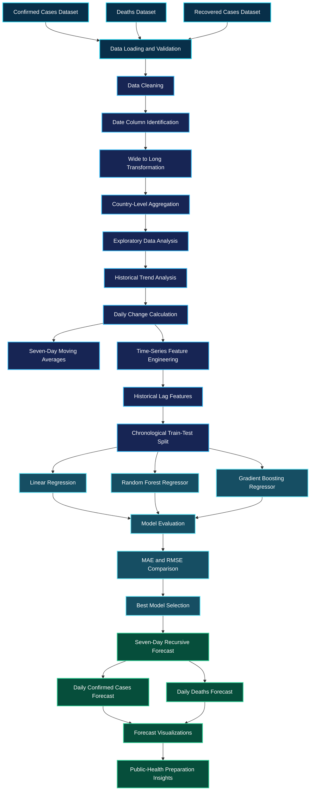
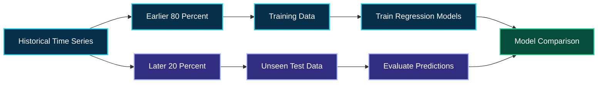
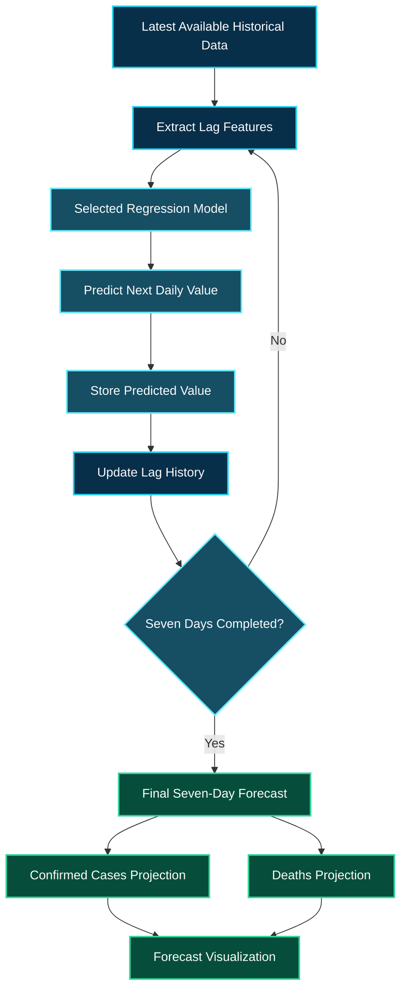

<div align="center">


<br/>

<a href="https://readme-typing-svg.demolab.com">

</a>

<br/><br/>


<br/><br/>

**A complete data science workflow for exploring global COVID-19 trends, comparing machine learning regression models, and forecasting daily cases and deaths in India.**

<br/>

[Project Overview](#01-project-overview)   |   [Architecture](#02-system-architecture)   |   [Exploratory Analysis](#05-exploratory-data-analysis)   |   [Machine Learning](#08-machine-learning-models)   |   [Forecasting](#11-seven-day-forecasting-engine)

</div>

---

# 01. Project Overview

## Turning Pandemic Data Into Predictive Insights

The COVID-19 pandemic demonstrated the importance of reliable public-health surveillance, historical data analysis, and short-term forecasting.

Large-scale epidemiological datasets contain valuable information about how reported cases, deaths, and recoveries change over time. Extracting useful information from these datasets requires systematic data preparation, statistical analysis, visualization, and predictive modeling.

This project uses the COVID-19 time-series data associated with the Johns Hopkins University Center for Systems Science and Engineering repository.

The notebook processes confirmed cases, deaths, and recovered cases, converts the original datasets into a country-level time-series structure, and investigates historical pandemic trends.

India is selected as the forecasting region.

Three machine learning regression algorithms are evaluated to predict daily confirmed cases and daily deaths. The forecasting period is fixed at seven days, and the best-performing model is selected separately for each target using the chronological test-set RMSE.

The resulting forecasts provide an analytical example of how historical surveillance data can support short-term public-health planning.

### Project Objectives

**Historical data intelligence**

Explore COVID-19 records and identify country-level patterns in confirmed cases, deaths, and recoveries.

**Time-series transformation**

Convert cumulative case counts into daily changes that can be analyzed as forecasting targets.

**Machine learning experimentation**

Train and compare multiple regression algorithms using historical observations.

**Forecasting and evaluation**

Evaluate predictions on a chronological test set and generate a seven-day recursive forecast.

**Public-health planning**

Translate forecast results into cautious, evidence-informed preparation suggestions for healthcare and surveillance teams.

## Project Information

| Property                  | Description                                                             |
| ------------------------- | ----------------------------------------------------------------------- |
| Project ID                | PRCP-1023                                                               |
| Project domain            | Healthcare                                                              |
| Project type              | Data analysis and time-series forecasting                               |
| Primary region            | India                                                                   |
| Data source               | Johns Hopkins CSSE COVID-19 time-series data                            |
| Main programming language | Python                                                                  |
| Development environment   | Jupyter Notebook                                                        |
| Forecasting horizon       | Seven days                                                              |
| Prediction targets        | Daily confirmed cases and daily deaths                                  |
| Algorithms                | Linear Regression, Random Forest Regressor, Gradient Boosting Regressor |
| Evaluation metrics        | Mean Absolute Error and Root Mean Squared Error                         |

---

# 02. System Architecture

## The Complete Data Intelligence Pipeline

The project follows a structured workflow that transforms historical epidemiological records into short-term forecasting results.

The pipeline begins with three datasets and continues through data cleaning, country-level aggregation, exploratory analysis, time-series feature engineering, model training, evaluation, and future prediction.



### Architecture Explanation

The three input datasets contain cumulative observations recorded across multiple dates.

After loading the data, the notebook removes duplicate records, identifies date columns, and reshapes the tables into a long format.

Records belonging to multiple provinces or states are aggregated to create country-level observations.

The resulting data is used for historical analysis and the calculation of daily changes.

Historical lag features are then constructed for forecasting. The observations are divided chronologically so that the test set contains later dates than the training set.

Three regression models are evaluated independently for confirmed cases and deaths.

Finally, the selected models generate seven-day forecasts, which are visualized and interpreted for analytical preparedness planning.

---

# 03. Data Sources and Dataset Structure

## Understanding the Input Data

The notebook uses three COVID-19 global time-series datasets associated with the Johns Hopkins University CSSE COVID-19 Data Repository.

The original files store geographic information in the initial columns and cumulative observations for different dates in subsequent columns.

### Dataset One: Confirmed Cases

The confirmed-cases dataset records the cumulative number of reported confirmed COVID-19 cases.

It is used to investigate the historical development of reported infections and construct the daily confirmed-case forecasting target.

### Dataset Two: Deaths

The deaths dataset records cumulative reported deaths associated with COVID-19.

It is used to investigate mortality trends and build a separate model for forecasting daily reported deaths.

### Dataset Three: Recoveries

The recovered-cases dataset records cumulative reported recoveries.

It supports historical trend analysis and provides additional context about reported pandemic outcomes.

The notebook does not build a separate seven-day recovery forecasting model.

### Original Data Structure

The datasets contain geographic metadata and date-based observations.

| Column           | Purpose                                                          |
| ---------------- | ---------------------------------------------------------------- |
| `Province/State` | Province or state associated with an observation, when available |
| `Country/Region` | Country or region associated with an observation                 |
| `Lat`            | Latitude information                                             |
| `Long`           | Longitude information                                            |
| Date columns     | Cumulative observations recorded on individual dates             |

The exact available dates depend on the dataset files supplied to the notebook.

### Why Data Transformation Is Necessary

Wide-format time-series data stores each date in a separate column.

Although this format is convenient for reporting, it is less convenient for many analytical operations.

The notebook converts the data into a long format in which each observation is associated with a geographic record, a date, and a measured value.

This representation makes it easier to aggregate observations, calculate daily changes, create visualizations, and build time-series features.

---

# 04. Data Engineering and Preprocessing

## Preparing Reliable Time-Series Data

The quality of a forecasting model depends heavily on the quality of its input data.

The project includes several preparation stages to make the original datasets suitable for analysis and prediction.

### Data Loading

The notebook automatically searches the working directory for the three required datasets.

This reduces the need to rename files manually and supports datasets supplied with or without a visible `.csv` extension.

### Data Validation

Initial inspection examines the shape of each dataset, its columns, missing values, and duplicate records.

These checks help identify structural inconsistencies before the data is transformed.

### Duplicate Removal

Duplicate rows are removed to reduce the risk of counting repeated records more than once.

### Date Column Identification

The notebook identifies columns that can be interpreted as dates.

This allows the time-series transformation to work without manually specifying every date column.

### Wide-to-Long Transformation

The `pandas.melt()` operation converts date columns into rows.

The transformed records contain geographic information, dates, and their corresponding cumulative measurements.

### Country-Level Aggregation

Some countries have separate records for multiple provinces or states.

The notebook sums these records by country and date to create country-level time series.

### Handling Historical Data Corrections

Reported cumulative totals may decrease when historical records are corrected.

The difference between consecutive cumulative totals can therefore be negative.

For the daily forecasting targets, the notebook replaces negative differences with zero because the target is intended to represent newly reported daily cases or deaths.

This is a modeling choice rather than a claim that negative corrections represent zero actual infections or deaths.

### Daily Change Calculation

Cumulative values and daily values describe different quantities.

Cumulative totals represent all cases or deaths reported up to a given date, while daily changes describe the difference between consecutive cumulative observations.

The notebook calculates daily values using the difference between consecutive dates.

Conceptually:

```python
daily_value = cumulative_value.diff()
```

The resulting daily observations form the targets used by the forecasting models.

---

# 05. Exploratory Data Analysis

## Discovering Patterns in Pandemic Data

Exploratory Data Analysis helps explain how COVID-19 observations change over time and how the data differs across countries.

The notebook examines global totals and historical trends before building the forecasting models.

### Global Summary Analysis

The initial analysis identifies the latest available date and examines countries with the largest reported cumulative confirmed-case and death totals.

This provides a high-level overview of the dataset at the time represented by the supplied files.

These rankings reflect the data available in the dataset, not necessarily current global rankings.

### India Confirmed-Case Trends

The confirmed-case analysis investigates how cumulative reported cases developed over time in India.

The cumulative series helps illustrate the overall growth and changing trajectory of reported cases.

The daily series provides a more direct view of short-term changes.

### India Death Trends

The death analysis examines the development of cumulative reported deaths and the daily changes derived from those totals.

Studying both representations helps distinguish long-term totals from changes observed over shorter periods.

### India Recovery Trends

The notebook also examines historical recovered-case data.

These observations add context to the broader analysis of pandemic reporting.

### Daily Case and Death Analysis

Daily counts are calculated from cumulative totals.

The notebook also uses seven-day moving averages to help smooth short-term fluctuations.

Moving averages can make broader trends easier to observe when individual daily values are affected by reporting delays, weekly patterns, or data revisions.

### Why Visualization Matters

Time-series visualizations can reveal changes that are difficult to identify from raw tables.

They help identify periods of increasing or decreasing reported activity, unusual observations, and possible changes in the behavior of the series.

However, visual trends alone do not establish the cause of changes in reported cases or deaths.

---

# 06. Feature Engineering

## Converting Historical Observations Into Predictive Features

Time-series forecasting requires the model to learn from information that would have been available before the prediction date.

The notebook constructs historical lag features for daily confirmed cases and daily deaths.

### Lag One

Lag 1 represents the previous day's observation.

It allows the model to learn how the most recent reported value relates to the next day's target.

### Lag Two

Lag 2 represents the observation from two days earlier.

This feature adds information about recent changes over a slightly longer interval.

### Lag Three

Lag 3 represents the observation from three days earlier.

It provides additional historical context for the prediction.

### Lag Seven

Lag 7 represents the observation from one week earlier.

This feature allows the model to use a value from the corresponding point in the previous week.

### Feature Table

| Feature | Description                           |
| ------- | ------------------------------------- |
| `Lag_1` | Daily value from one day earlier      |
| `Lag_2` | Daily value from two days earlier     |
| `Lag_3` | Daily value from three days earlier   |
| `Lag_7` | Daily value from seven days earlier   |
| Target  | Daily confirmed cases or daily deaths |

The exact column names in the notebook may differ depending on how the feature-generation function is implemented.

### Why Lag Features Matter

Lag features transform a sequential forecasting problem into a supervised regression problem.

The models learn relationships between historical observations and a future daily value.

This approach makes it possible to compare standard machine learning regression algorithms using a consistent set of time-series inputs.

It also preserves the chronological relationship between past observations and future targets.

---

# 07. Chronological Train-Test Split

## Preserving the Direction of Time

A forecasting model should be evaluated on observations that occur after the observations used to train it.

The notebook uses a chronological 80:20 split.

The earlier 80 percent of observations are used for training, and the later 20 percent are reserved for testing.



### Why Random Splitting Is Avoided

Randomly mixing dates between the training and testing sets can allow information from later periods to influence training.

This may produce an overly optimistic evaluation for a forecasting task.

Chronological splitting better reflects the real-world situation in which historical data is available first and future observations must be predicted.

It does not eliminate every possible source of bias, but it is an appropriate starting point for evaluating time-series models.

---

# 08. Machine Learning Models

## Three Regression Algorithms. Two Forecasting Targets.

The project evaluates three machine learning algorithms.

Each algorithm is trained and evaluated separately for daily confirmed cases and daily deaths.

### Linear Regression

Linear Regression models a linear relationship between the historical lag features and the target variable.

It provides a relatively simple baseline and helps establish whether the available lag features contain useful predictive information under a linear assumption.

Its main limitation is that it may not capture complex nonlinear relationships in the time series.

### Random Forest Regressor

Random Forest combines multiple decision trees to produce a regression prediction.

It can capture nonlinear relationships between lag features and the target.

The ensemble approach can also reduce the sensitivity of predictions to individual tree structures.

Its effectiveness depends on the available data, feature design, model settings, and evaluation period.

### Gradient Boosting Regressor

Gradient Boosting builds an ensemble of decision trees sequentially.

Each successive stage attempts to improve the ensemble's performance by addressing errors from earlier stages.

It can capture nonlinear relationships, although its performance depends on appropriate model configuration and the characteristics of the dataset.

### Model Comparison Summary

| Model                       | Learning Approach   | Main Purpose                      |
| --------------------------- | ------------------- | --------------------------------- |
| Linear Regression           | Linear regression   | Establish a baseline              |
| Random Forest Regressor     | Tree-based ensemble | Capture nonlinear relationships   |
| Gradient Boosting Regressor | Sequential boosting | Learn complex predictive patterns |

The project does not assume that one algorithm must be best for every forecasting target.

The best model for confirmed cases can differ from the best model for deaths because the two series may have different statistical characteristics and error patterns.

---

# 09. Model Evaluation Framework

## Measuring Forecasting Error

The notebook compares model predictions with actual observations from the chronological test period.

Two evaluation metrics are used: Mean Absolute Error and Root Mean Squared Error.

### Mean Absolute Error

Mean Absolute Error measures the average absolute difference between actual values and predicted values.

Lower MAE indicates smaller average absolute errors.

MAE is expressed in the same units as the target variable.

For daily confirmed cases, the unit is reported daily cases. For daily deaths, it is reported daily deaths.

### Root Mean Squared Error

Root Mean Squared Error measures the square root of the average squared prediction errors.

Because the errors are squared before averaging, larger errors have a stronger influence on RMSE.

Lower RMSE indicates smaller errors under this metric.

The notebook selects the model with the lowest test-set RMSE for each forecasting target.

### Why Both Metrics Are Used

MAE gives a straightforward measure of average absolute error.

RMSE is more sensitive to large prediction errors.

Considering both metrics provides a more informative comparison than relying on a single performance measure.

Neither metric alone establishes whether a forecast is sufficiently reliable for public-health decisions.

---

# 10. Model Comparison Dashboard

## Independent Model Selection for Cases and Deaths

The notebook creates separate model-comparison results for confirmed cases and deaths.

The actual numerical scores are calculated when the notebook is executed using the supplied datasets.

The following tables provide a reporting template for those results.

### Confirmed Cases Model Comparison

| Regression Model            |              Test MAE |             Test RMSE |
| --------------------------- | --------------------: | --------------------: |
| Linear Regression           | Generated by notebook | Generated by notebook |
| Random Forest Regressor     | Generated by notebook | Generated by notebook |
| Gradient Boosting Regressor | Generated by notebook | Generated by notebook |
| Selected model              |    Lowest-error model |    Lowest-error model |

### Deaths Model Comparison

| Regression Model            |              Test MAE |             Test RMSE |
| --------------------------- | --------------------: | --------------------: |
| Linear Regression           | Generated by notebook | Generated by notebook |
| Random Forest Regressor     | Generated by notebook | Generated by notebook |
| Gradient Boosting Regressor | Generated by notebook | Generated by notebook |
| Selected model              |    Lowest-error model |    Lowest-error model |

These are documentation templates, not measured scores.

The notebook's evaluation cells provide the actual results. Once the notebook is run, the corresponding numerical MAE and RMSE values can be inserted into these tables.

### Actual Versus Predicted Analysis

The notebook generates visual comparisons between actual and predicted values for the confirmed-case and death targets.

These visualizations help assess whether the model follows the broad direction of the observed series.

They can also reveal periods in which predictions substantially differ from actual observations.

A model with a low average error can still perform poorly during sudden increases or other unusual periods.

---

# 11. Seven-Day Forecasting Engine

## Recursive Time-Series Prediction

The forecasting horizon is fixed at seven days.

The selected model generates predictions for daily confirmed cases and daily deaths separately.

The forecasting procedure is recursive because future lag values are not directly available at the time of prediction.

### Forecasting Architecture



### Step One: Use the Latest Historical Observations

The model starts with the latest available daily observations.

These observations provide the lag features required for the first forecast.

### Step Two: Predict the Next Day

The selected regression model predicts the daily target using the available lag values.

### Step Three: Update the Historical Sequence

The newly predicted value is added to the history used by the forecasting function.

This updated sequence supplies the lag values required for the next prediction.

### Step Four: Repeat the Process

The process continues until predictions have been generated for all seven future days.

### Step Five: Visualize the Forecast

The notebook presents the forecast results for daily confirmed cases and daily deaths.

The visualizations provide a way to compare the historical series with the projected values.

### Important Forecasting Limitation

Recursive forecasting can accumulate errors because predicted values become inputs for later predictions.

Consequently, uncertainty generally increases as the forecast moves further into the future.

The seven-day projections should be treated as model-based estimates rather than guaranteed future outcomes.

---

# 12. Forecast Interpretation

## From Predictions to Analytical Insights

A forecasting result is most useful when its limitations and intended purpose are clearly understood.

The project focuses on daily reported cases and deaths rather than predicting a guaranteed future cumulative total.

### Confirmed Cases

The confirmed-case forecast provides a short-term projection of reported daily cases.

It can be examined alongside recent observations and seven-day moving averages to understand the direction of the model's projection.

An increasing projected series may indicate that closer monitoring deserves consideration.

A decreasing projected series does not prove that transmission has ended or that healthcare demand will necessarily decline.

### Deaths

The death forecast provides a separate projection of daily reported deaths.

Deaths may follow different temporal patterns from confirmed cases, so the project evaluates this target independently.

The predicted daily death series should not be interpreted as a direct measurement of future mortality risk for a particular individual.

### Actual Versus Forecasted Values

Comparing the forecast with later observed values is an important step in evaluating whether the model generalizes to new data.

A future model assessment should record:

* The forecast creation date.
* The historical data cutoff date.
* The selected model for each target.
* The predicted values.
* The subsequently observed values.
* The resulting forecast errors.

This information can help determine whether the forecasting process remains useful when new surveillance data becomes available.

---

# 13. Public-Health Preparation Framework

## Using Forecasts Responsibly

The notebook concludes with preparation suggestions based on the analytical workflow.

These suggestions are intended to support discussion and planning, not to replace epidemiological assessment or professional public-health judgment.

### Surveillance and Monitoring

Monitor daily reported cases and deaths alongside seven-day moving averages.

Use changes in the observed data to identify periods that may require closer investigation.

### Healthcare Resource Planning

Consider short-term projections as one source of information when reviewing staffing, healthcare capacity, and essential medical supplies.

Resource decisions should also incorporate actual hospital utilization, regional surveillance, and other relevant public-health information.

### Model Monitoring

Compare forecasts with subsequently observed values.

Track prediction errors and investigate periods in which the model performs poorly.

### Data Quality

Maintain awareness of historical revisions, reporting delays, and changes in data collection practices.

These factors can influence the patterns learned by a forecasting model.

### Adaptive Preparedness

Use flexible preparation plans that can be updated as new information becomes available.

Forecasts should inform decisions alongside current surveillance and epidemiological evidence rather than being treated as definitive predictions.

---

# 14. Challenges and Solutions

## Engineering Challenges Addressed in the Project

### Challenge One: Wide-Format Time-Series Data

The original datasets store dates in separate columns, making some time-series operations inconvenient.

**Solution:** Use `pandas.melt()` to transform the data into long format.

### Challenge Two: Multiple Geographic Records

Countries may contain several province or state records.

**Solution:** Aggregate observations by country and date.

### Challenge Three: Cumulative Versus Daily Counts

Cumulative totals do not directly represent the number of newly reported cases or deaths on an individual day.

**Solution:** Calculate daily changes using differences between consecutive cumulative observations.

### Challenge Four: Historical Data Revisions

Reported cumulative totals may decrease after corrections.

**Solution:** Clip negative daily differences to zero for the model's daily forecasting targets.

This simplifies the modeling target but can remove information about the magnitude of historical corrections.

### Challenge Five: Time-Series Data Leakage

Random train-test splitting can mix observations from different periods.

**Solution:** Use a chronological 80:20 split so the test observations occur after the training observations.

### Challenge Six: Different Target Behaviors

Confirmed cases and deaths may have different distributions and temporal patterns.

**Solution:** Evaluate the regression algorithms separately for each target and select the model based on the corresponding test-set RMSE.

### Challenge Seven: Future Lag Availability

The actual values for future dates are unavailable when the forecast is generated.

**Solution:** Use recursive forecasting, feeding each prediction into the lag history for the next forecast step.

---

# 15. Repository Structure

## Project Organization

The main deliverable is a Jupyter Notebook containing the data preparation, analysis, model comparison, forecasting, and final conclusions.

```text
COVID19-Data-Analysis-and-Forecasting/
|
|-- covid19 (1).ipynb
|
|-- README.md
|
|-- time_series_covid19_confirmed_global.csv
|
|-- time_series_covid19_deaths_global.csv
|
|-- time_series_covid19_recovered_global.csv
|
|-- assets/
|   |
|   |-- architecture.png
|   |-- global_trends.png
|   |-- india_confirmed_cases.png
|   |-- india_daily_cases.png
|   |-- confirmed_model_comparison.png
|   |-- deaths_model_comparison.png
|   |-- confirmed_forecast.png
|   |-- deaths_forecast.png
|
|-- requirements.txt
|
|-- .gitignore
|
|-- LICENSE
|
```

The three dataset filenames shown above are illustrative names. Use the actual names of the files supplied to your notebook.

The `assets` directory, `requirements.txt`, `.gitignore`, and `LICENSE` are recommended additions to the repository structure. They should not be considered existing project files unless they have been created and uploaded.

The notebook automatically searches the current working directory for the three required dataset files.

---

# 16. Installation and Execution

## Environment Requirements

The project uses Python and common data science libraries.

A compatible Python environment with the required dependencies is recommended.

### Step One: Clone the Repository

Replace the example repository address with your actual GitHub repository URL.

```bash
git clone YOUR_GITHUB_REPOSITORY_URL
```

### Step Two: Open the Project Folder

Move into the downloaded project directory.

```bash
cd YOUR_PROJECT_FOLDER
```

### Step Three: Install the Dependencies

Run the following command in your terminal.

```bash
python -m pip install numpy pandas matplotlib scikit-learn jupyter
```

### Step Four: Place the Dataset Files

Place the confirmed, deaths, and recovered datasets in the same working directory as the notebook, or configure the notebook to search the appropriate dataset folder.

The notebook supports the expected dataset names with or without a visible `.csv` extension.

### Step Five: Start Jupyter Notebook

```bash
jupyter notebook
```

### Step Six: Open the Notebook

Open `covid19 (1).ipynb`.

Run the cells in order, beginning with library imports and dataset discovery.

### Step Seven: Review the Outputs

Inspect the generated outputs, including:

* Dataset validation results.
* Global COVID-19 summaries.
* India historical trend charts.
* Daily case and death series.
* Model evaluation tables.
* Actual-versus-predicted visualizations.
* Seven-day forecast tables.
* Forecast charts.
* Final preparation suggestions.

The exact numerical results depend on the dataset files used during execution.

---

# 17. Technologies and Technical Skills

## Data Science and Machine Learning

The project demonstrates the application of data science methods to a real-world time-series problem.

| Skill                   | Application                                                  |
| ----------------------- | ------------------------------------------------------------ |
| Python                  | Main programming language                                    |
| Pandas                  | Data loading, cleaning, reshaping, and aggregation           |
| NumPy                   | Numerical operations                                         |
| Matplotlib              | Historical trends and forecasting visualizations             |
| Scikit-learn            | Regression model training and evaluation                     |
| Data cleaning           | Duplicate removal and column normalization                   |
| Time-series analysis    | Chronological observations and daily changes                 |
| Feature engineering     | Historical lag features                                      |
| Regression              | Predicting numerical daily counts                            |
| Model evaluation        | MAE and RMSE                                                 |
| Forecasting             | Seven-day recursive predictions                              |
| Data visualization      | Historical and predicted series                              |
| Public-health analytics | Translating forecast results into cautious planning insights |
| Jupyter Notebook        | Reproducible analytical workflow                             |
| GitHub Markdown         | Project documentation                                        |

---

# 18. Future Enhancements

## Moving Toward a More Complete Forecasting System

The current notebook provides an educational forecasting workflow. Several enhancements could improve its analytical depth and usability.

### Improved Forecasting Methods

Compare the current regression models with suitable statistical time-series approaches and stronger forecasting baselines.

Any additional model should be evaluated using the same chronological evaluation framework.

### Baseline Forecast Comparison

Include simple persistence and moving-average forecasts.

These baselines can reveal whether a more complex machine learning model offers a meaningful improvement over straightforward forecasting strategies.

### Forecast Uncertainty

Investigate prediction intervals or other appropriate methods for communicating uncertainty.

A single predicted value does not describe the full range of plausible future outcomes.

### Enhanced Feature Engineering

Explore additional historical features, rolling statistics, and calendar-related variables where justified by the data.

All features must be constructed without introducing future information into the training process.

### Automated Evaluation

Record model parameters, dataset cutoffs, evaluation metrics, and forecast results in a structured format.

This would make it easier to compare successive experiments.

### Interactive Dashboard

Build a Streamlit application that presents historical trends, model comparisons, and seven-day forecasts in an interactive interface.

### Model Monitoring

Compare future observations against previous predictions and track changes in forecast errors over time.

### Reproducible Environment

Add a maintained dependency file, documented data requirements, and automated checks that validate the input datasets before training.

---

# 19. Limitations and Responsible Use

This project is an educational data science and machine learning exercise.

The results depend on the quality, coverage, reporting practices, and historical period of the supplied dataset.

Reported COVID-19 cases and deaths do not necessarily capture every infection or death. Reporting delays, revisions, changes in testing practices, public-health interventions, vaccination, population behavior, and other factors can affect observed trends.

The models use historical lag features. They do not explicitly model every epidemiological mechanism or external factor that may influence future disease activity.

Recursive forecasts may accumulate errors as predicted values become inputs to subsequent predictions.

A chronological test set provides a useful evaluation, but it does not establish that the model will remain accurate during future waves or in other populations.

The forecast outputs must not be interpreted as guaranteed future counts or as a substitute for epidemiological models, official surveillance, or expert public-health assessment.

Any operational use would require more extensive validation, uncertainty analysis, monitoring, and appropriate expert oversight.

---

# 20. Final Conclusion

## From Historical Data to Short-Term Forecasting

This project demonstrates a complete data science workflow for analyzing COVID-19 time-series data and producing short-term forecasts.

The three supplied datasets are cleaned, reshaped, and aggregated to create country-level observations.

Historical trends in confirmed cases, deaths, and recoveries are explored, with India selected as the forecasting region.

Daily confirmed cases and daily deaths are derived from cumulative totals. Historical lag features are then constructed to support supervised regression.

Linear Regression, Random Forest Regressor, and Gradient Boosting Regressor are evaluated using a chronological train-test split.

The models are compared using MAE and RMSE, and the model with the lowest test-set RMSE is selected separately for confirmed cases and deaths.

Finally, recursive forecasting generates seven-day projections for both targets.

The project illustrates the value of combining data preparation, exploratory analysis, feature engineering, model evaluation, and responsible interpretation in a single reproducible workflow.

Its central lesson is that useful forecasting requires more than producing predictions. It also requires understanding the data, evaluating model errors, recognizing uncertainty, and interpreting results within their appropriate context.

---

# 21. About the Developer

<div align="center">

<a href="https://readme-typing-svg.demolab.com">

</a>

<br/><br/>

<a href="https://github.com/govardhan-goud123">

</a>

<br/><br/>

Interested in Data Science, Artificial Intelligence, Machine Learning, Natural Language Processing, predictive analytics, and practical data-driven applications.

</div>

---

<div align="center">


### DATA. PATTERNS. PREDICTIONS.

**Transforming historical observations into analytical insights.**

</div>
